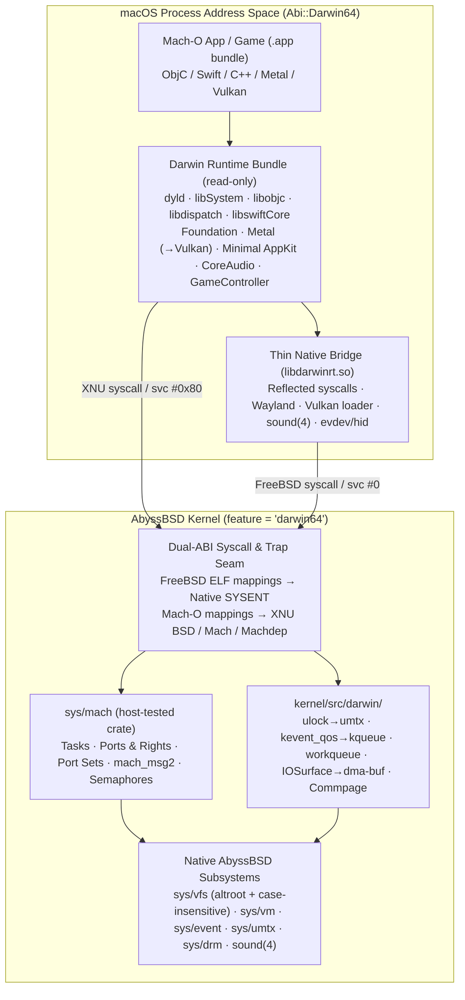

# macOS Applications and Games (Darwin / XNU Personality)

- Status: **Exploratory / Non-committed Forward Design**. A high-level architectural assessment for running unmodified 64-bit macOS applications and games on AbyssBSD, positioned as a third compatibility personality alongside [LINUXULATOR.md](file:///home/jkane/Projects/OS/AbyssBSD-Rust/docs/LINUXULATOR.md) (`Abi::Linux64`) and [WINDOWS-GAMES.md](file:///home/jkane/Projects/OS/AbyssBSD-Rust/docs/WINDOWS-GAMES.md) (`Abi::Nt64`).
- Date: 2026-11-24
- Scope: an in-kernel Darwin/XNU 64-bit personality on `x86_64` and `aarch64` (Mach IPC/ports, Mach traps, XNU BSD syscall edge translation, commpage, `ulock`/`workqueue`/`kevent_qos`, `IOSurface`), the user runtime (Mach-O loader, `dyld`, Objective-C and Swift ABIs, `libSystem`, `libdispatch`, Metal-to-Vulkan translation, minimal AppKit/CoreAudio/GameController over Wayland/`sound(4)`/`evdev`), and immutable runtime bundles.
- Inputs: [LINUXULATOR.md](file:///home/jkane/Projects/OS/AbyssBSD-Rust/docs/LINUXULATOR.md), [WINDOWS-GAMES.md](file:///home/jkane/Projects/OS/AbyssBSD-Rust/docs/WINDOWS-GAMES.md), [VISION.md](file:///home/jkane/Projects/OS/AbyssBSD-Rust/docs/VISION.md), [ADR-0005](file:///home/jkane/Projects/OS/AbyssBSD-Rust/docs/adr/0005-monolithic-static-kernel.md), [ADR-0007](file:///home/jkane/Projects/OS/AbyssBSD-Rust/docs/adr/0007-license-and-clean-implementation.md), [ADR-0011](file:///home/jkane/Projects/OS/AbyssBSD-Rust/docs/adr/0011-performance-parity.md), [ADR-0014](file:///home/jkane/Projects/OS/AbyssBSD-Rust/docs/adr/0014-performance-parity-per-component.md), and Apple's published Darwin/XNU interfaces.

> [!IMPORTANT]
> **The honest headline:** Unlike Linux (standardized POSIX/ELF + Mesa) and Windows (where DXVK, vkd3d-proton, FAudio, and decades of Win32 compatibility work exist), **running macOS GUI apps and Metal games on a non-Apple OS is largely greenfield.** AbyssBSD has a major structural advantage at the kernel layer—XNU's BSD half is FreeBSD's cousin, and in-kernel Mach IPC avoids Darling's userspace-server bottleneck—but the *userland mountain* (Metal → Vulkan + shader translation, Objective-C/Swift frameworks, and AppKit/CoreGraphics) is substantially larger than Windows's. A viable design must therefore split the problem cleanly: **CLI/Darwin tools first, then game-viable Cocoa + Metal (and Vulkan-passthrough), with general macOS desktop apps (full AppKit/SwiftUI) treated as a much longer horizon.**

---

## 1. Goals and Non-goals

### 1.1 Goals

| # | Goal | Why |
|---|---|---|
| G1 | **Unmodified 64-bit Mach-O binaries run on `x86_64` and `aarch64`**: universal ("fat") and single-slice binaries from direct downloads, Steam/GOG/itch.io, and CLI toolchains | Matches AbyssBSD's 64-bit dual-ISA model ([VISION.md](file:///home/jkane/Projects/OS/AbyssBSD-Rust/docs/VISION.md)) |
| G2 | **In-kernel Mach + BSD semantics, no hot-path server**: Mach ports, port rights, `mach_msg`/`mach_msg2`, `ulock`, `workqueue`, and XNU BSD syscalls live in the kernel (`sys/mach` + `kernel/src/darwin/`), avoiding a `darlingserver` bottleneck | Mirrors `WINDOWS-GAMES.md` G3 (`sys/ntobj`); leverages AbyssBSD's native `kqueue`, `umtx`, `sysctl`, and `dma-buf` |
| G3 | **Zero cost to native FreeBSD processes**: `Abi::Darwin64` is a fourth variant on `Process`'s `Abi` enum, gated behind `feature = "darwin64"`, with zero overhead on `FreeBsd64` hot paths | [ADR-0005](file:///home/jkane/Projects/OS/AbyssBSD-Rust/docs/adr/0005-monolithic-static-kernel.md), [ADR-0011](file:///home/jkane/Projects/OS/AbyssBSD-Rust/docs/adr/0011-performance-parity.md) |
| G4 | **Games before general desktop suites**: prioritize the small Cocoa/AppKit/CoreAudio/GameController/Metal surface that cross-platform game engines (Unity, Unreal, Godot, SDL2/3, Feral/Aspyr ports) actually call | Reaches real graphical workloads years earlier than reimplementing all of AppKit/SwiftUI |
| G5 | **Immutable versioned bundles + per-app isolation**: reuse the bundle/manifest/jail architecture from [WINDOWS-GAMES.md](file:///home/jkane/Projects/OS/AbyssBSD-Rust/docs/WINDOWS-GAMES.md) §8 for macOS `.app` bundles | Prevents framework updates from regressing working titles |
| G6 | **Clean provenance**: BSD-2-Clause Rust for kernel and AbyssBSD-authored runtime components; no GPL code consulted; explicit policy decision on Apache-2.0 and APSL-2.0 upstream Darwin components (§8) | [ADR-0007](file:///home/jkane/Projects/OS/AbyssBSD-Rust/docs/adr/0007-license-and-clean-implementation.md) |
| G7 | **No silent stubs**: unimplemented Mach traps, BSD syscalls, or ObjC selectors fail explicitly and log once via `crate::firstuse` | Matches `LINUXULATOR.md` and `WINDOWS-GAMES.md` G8 |

### 1.2 Non-goals

- **Mac App Store FairPlay DRM (`LC_ENCRYPTION_INFO_64`)**: encrypted binaries require Apple hardware keys and Secure Enclave / FairPlay decryption. They are rejected at load time with a clear diagnostic.
- **`arm64e` Pointer Authentication (PAC) binaries**: Apple reserves `arm64e` for its own system binaries and frameworks. Third-party macOS apps and games ship standard `arm64` (and/or `x86_64`) slices; `arm64e` slices are out of scope unless hardware PAC is present and explicitly enabled later.
- **32-bit macOS (`i386`, `ppc`)**: Apple itself dropped 32-bit in macOS 10.15 (Catalina, 2019), aligning cleanly with AbyssBSD's 64-bit-only rule.
- **Cross-ISA execution (`x86_64` macOS binaries on `aarch64`, or `arm64` on `x86_64`) in v1**: Rosetta-style binary translation is a separate orthogonal layer, same as `WINDOWS-GAMES.md` §1.2.
- **IOKit kernel extensions (`.kext`) or DriverKit system extensions**: no Apple kernel drivers are ever loaded. Userland IOKit queries (`IOServiceMatching`, HID, GPU/display properties) are answered by user/kernel shims over native AbyssBSD subsystems.
- **Full macOS desktop replacement (SwiftUI, WebKit, iCloud, Keychain/TouchID, MetalFX upscaling, Game Center)** in initial phases.

---

## 2. Reality Check: Why macOS Differs from Linux & Windows

Prior art in this space—chiefly **Darling** (Linux) and **ravynOS/Airyx** (FreeBSD)—reveals where the real difficulty lies:

| Layer | Linux (`Abi::Linux64`) | Windows (`Abi::Nt64`) | macOS (`Abi::Darwin64`) |
|---|---|---|---|
| **Kernel ABI gap** | Small (POSIX/ELF; `epoll`→`kqueue`, `futex`→`umtx`) | Medium-High (NT objects, wait-all, handles, sections) | **Medium** — BSD half is FreeBSD's cousin (`kqueue`, `sysctl`, `umtx`), *plus* Mach IPC/ports (`sys/mach`) |
| **Calling convention gap** | None (SysV) | High on `x86_64` (MS ABI vs SysV thunks) | **Minimal** (SysV AMD64 / AAPCS64; minor `arm64` variadic & `x18` quirks) |
| **Executable & runtime ABI** | ELF + C/C++ | PE + C/C++ + COM | **Complex** — Mach-O, Universal/Fat, `dyld` shared cache, ObjC 64-bit non-fragile ABI, Swift 5+ ABI |
| **Graphics translation** | Native Mesa Vulkan/GL | Mature (DXVK, vkd3d-proton → Vulkan) | **Greenfield** — Metal → Vulkan (`Indium`/`Iridium` are early); runtime MSL compilation has *no* mature open-source SPIR-V compiler |
| **GUI / System frameworks** | Standard Wayland/GTK/Qt | Wine exists (massive, mature) | **Greenfield** — AppKit, CoreGraphics, CoreAnimation, CoreText, CoreAudio are closed-source; GNUstep/Cocotron cover only a fraction |

### AbyssBSD's Structural Advantages Over Darling (on Linux)
1. **Native BSD primitives**: XNU's BSD layer shares heritage with FreeBSD. `kqueue`/`kevent64`, `sysctl`, BSD sockets, `posix_spawn`, and `umtx` map far more directly onto AbyssBSD than onto Linux's `epoll`/`futex`/procfs.
2. **In-kernel Mach IPC (`sys/mach`)**: Darling had to build `darlingserver` (a userspace daemon, analogous to `wineserver`) because Linux will not merge Mach port tables. AbyssBSD owns its kernel and can put Mach ports, port sets, and `mach_msg2` directly in `sys/mach` with zero server-process round trips.
3. **Shared personality infrastructure**: `LINUXULATOR.md` and `WINDOWS-GAMES.md` already introduce the exact kernel seams `Darwin64` needs: `Process::abi`, VFS `altroot`, case-insensitive `namei` lookup, `imgact_binmisc`, mapping-origin syscall dispatch, `shared_page` timehands, `sys/drm` + `dma-buf`, and `sound(4)` native streams.

---

## 3. Architectural Overview



---

## 4. The Darwin / XNU Kernel Personality (`Abi::Darwin64`)

### 4.1 `Process` Personality & Dual-ABI Address Space

`Abi` in `kernel/src/proc.rs` adds a fourth variant:

```rust
pub(crate) enum Abi {
    FreeBsd64,
    #[cfg(feature = "linux64")]
    Linux64(Arc<LinuxProcData>),
    #[cfg(feature = "nt64")]
    Nt64(Arc<NtProcData>),
    #[cfg(feature = "darwin64")]
    Darwin64(Arc<DarwinProcData>), // Mach task port, IPC space, workqueue, commpage
}
```

Just like `Abi::Nt64`, a macOS graphical process hosts both **Mach-O code** (the app and Darwin frameworks) and **native FreeBSD ELF code** (`libdarwinrt.so`, Mesa's Vulkan driver, `libwayland-client`, FreeBSD `libc`) in the same address space so GPU and Wayland calls never cross a process boundary:

- **`x86_64` syscall discrimination**: Both FreeBSD and XNU execute `syscall` with the number in `rax`. We reuse `WINDOWS-GAMES.md` §4.2's **per-mapping origin** (`Native` vs `Darwin`) tracked in `sys/vm`: syscalls from native mappings hit FreeBSD's `SYSENT`; syscalls from Darwin mappings hit XNU dispatch, which decodes XNU's class bits in `rax`:
  - `0x2000000 | nr` → **BSD syscall** (returns value in `rax`, error in `rax` with `CF=1`, matching FreeBSD's carry-flag convention!).
  - `0x1000000 | nr` → **Mach trap** (returns `kern_return_t` in `rax`, `CF=0`).
  - `0x3000000 | nr` → **Machdep trap** (e.g., `thread_fast_set_cthread_self` for `GSBASE`).
- **`aarch64` syscall discrimination**: Cleanly separated in hardware!
  - FreeBSD uses `svc #0` with syscall number in `x8`.
  - XNU uses **`svc #0x80`** with syscall number in **`x16`** (positive = BSD syscall, negative = Mach trap, `x16 == -2147483648` / special = Machdep). The exception vector separates them in a single comparison on `ESR_EL1.ISS`.
- **Thread-Local Storage (TLS)**:
  - `x86_64`: FreeBSD userland uses `FSBASE`; Darwin `libpthread` uses `GSBASE` (no conflict, identical to `Abi::Nt64`).
  - `aarch64`: FreeBSD userland uses `TPIDR_EL0`; XNU stores the pthread TSD pointer in **`TPIDRRO_EL0`** (read-only at EL0, written by kernel on `thread_set_tsd_base`). Zero conflict with FreeBSD!
  - **`x18` on `aarch64`**: Apple's ARM64 ABI reserves `x18` as a platform register (like Windows on Arm). Native FreeBSD libc may clobber `x18`, so `libdarwinrt.so` thunks save/restore `x18` across the boundary.

### 4.2 The ARM64 16 KiB Page Size Problem

Apple Silicon enforces a **16 KiB** virtual page size (`0x4000`), whereas AbyssBSD on `aarch64` runs with **4 KiB** pages (`0x1000`):
- **Good news**: Running 16 KiB-aligned Mach-O binaries on a 4 KiB hardware kernel is *tractable* (unlike the reverse). Every 16 KiB Mach-O segment (`__TEXT`, `__DATA`, `__LINKEDIT`) maps cleanly onto four 4 KiB pages.
- **Required personality rules on `aarch64`**:
  1. Report `vm_page_size = 16384` and `vm_page_shift = 14` in the commpage and `sysctl` (`hw.pagesize`).
  2. Round all Darwin `mmap`, `mach_vm_allocate`, `mach_vm_protect`, and `mach_vm_deallocate` addresses/lengths to 16 KiB boundaries.
  3. Enforce 16 KiB alignment in `dyld` / Mach-O segment mapping.

### 4.3 System Call Placement (Kernel vs. Reflected)

Adopting `WINDOWS-GAMES.md` §4.3's placement model in `lib/darwin-abi` (host-tested, zero `unsafe`):
- **Kernel**: hot-path and cross-process primitives (`mach_msg` / `mach_msg2`, port/task/thread/VM traps, `ulock_wait`/`ulock_wake`, `kevent64`/`kevent_qos`, `workqueue`, BSD file/socket/process syscalls, `IOSurface` ioctls).
- **Reflected**: cold or process-local calls routed back to `libdarwinrt.so` in userspace (exotic `sysctl`s, `csops` code-signing queries, `necp` network policy stubs, `sandbox_ms` / Seatbelt policy stubs).
- **Unimplemented**: returns `ENOSYS` / `KERN_NOT_SUPPORTED` and logs once via `crate::firstuse`.

### 4.4 `sys/mach`: In-Kernel Mach Microkernel Primitives

A standalone, host-testable crate (`sys/mach`, sibling to `sys/ntobj`) implementing the exact subset of Mach that Darwin userland actually requires:
- **Tasks & Threads**: lightweight wrappers referencing AbyssBSD's `Process` and `UserThread`, exposing `task_self_trap`, `thread_self_trap`, `task_for_pid` (restricted by credentials), and Mach thread state inspection.
- **IPC Space & Mach Ports**: per-task port name table mapping `mach_port_name_t` → capability rights (`SEND`, `SEND_ONCE`, `RECEIVE`, `DEAD_NAME`, `PORT_SET`), with reference counting, death notifications (`MACH_NOTIFY_DEAD_NAME`), and kernel-enforced port transfer.
- **`mach_msg` & `mach_msg2`**: in-kernel synchronous/asynchronous message queues supporting inline payloads, **port right descriptors** (passing capabilities between processes), **out-of-line (OOL) memory descriptors** (backed by copy-on-write VM object slices in `sys/vm`), and audit/security trailers.
- **Mach Semaphores & Clock Services**: `semaphore_wait`/`semaphore_signal` over `sys/sched` sleep queues; `mach_wait_until` over kernel timers.

### 4.5 XNU BSD Subsystem Mapping

| XNU / Darwin Primitive | AbyssBSD Backing Engine | Notes |
|---|---|---|
| **`__ulock_wait` / `__ulock_wake`** (`os_unfair_lock`, `pthread_mutex`) | `sys/umtx` | Direct semantic match (`UL_COMPARE_AND_WAIT`, `UL_UNFAIR_LOCK` with owner-tid PI) |
| **`kevent64` / `kevent_qos`** | `sys/event` (`kqueue`) | Adds 64-bit `udata`/ext fields and QoS priority hints onto native `kqueue` |
| **`bsdthread_*` / `workq_kernreturn`** (Grand Central Dispatch) | `UserThread` + `sys/sched` | Kernel-managed worker thread pool scaling for `libdispatch` queues |
| **Commpage** (`0x7fffffe00000` x86_64 / `0x0000000fffffc000` arm64) | `kernel/src/shared_page.rs` | Read-only page fed from existing `Timehands` for lockless `mach_absolute_time()` & CPU caps |
| **Case-insensitive paths & `/compat/darwin`** | `sys/vfs` (`altroot` + case flag) | Reuses `LINUXULATOR.md` §6 (`altroot`) and `WINDOWS-GAMES.md` §6 (folded-name index) |
| **Extended attributes & `getattrlist`** | `sys/vfs` extattrs + `stat` | Resource forks (`com.apple.ResourceFork`), Finder info, creation time (`birthtime`) |
| **`IOSurface`** | `sys/drm` + `dma-buf` / `shm` | Cross-process zero-copy GPU/compositor surfaces mapped directly to `dma-buf` |
| **Mach Exceptions** (`EXC_BAD_ACCESS`, `EXC_CRASH`) | `kernel/src/signal/` seam | Delivered to task/thread exception port if registered, else BSD signal frame |

---

## 5. Loader, Language Runtimes & System Services

### 5.1 Mach-O Parsing & Launch (`lib/macho` + `darwinrun`)
- **`lib/macho`** (host-tested, `no_std`, zero `unsafe`): parses 64-bit Mach-O headers, Universal/Fat archives (selecting the host ISA slice), `LC_SEGMENT_64`, `LC_MAIN`, `LC_LOAD_DYLIB` / `LC_LOAD_WEAK_DYLIB` / `LC_RPATH`, `LC_DYLD_CHAINED_FIXUPS`, `LC_DYLD_EXPORTS_TRIE`, and `LC_CODE_SIGNATURE` (parsed/ignored for execution, while `LC_ENCRYPTION_INFO_64` with `cryptid != 0` fails cleanly as FairPlay DRM).
- **Activation**: Like `WINDOWS-GAMES.md` §4.5, the kernel does **not** parse Mach-O. `imgact_binmisc` dispatches Mach-O magic (`0xFEEDFACF`, `0xCFFAEDFE`, `0xCAFEBABE`/`0xBEBAFECA`) to native launcher `darwinrun`, which enters `Abi::Darwin64` via `procctl`, maps the dynamic linker (`dyld`) as a Darwin mapping, and hands control to `dyld`.
- **Dyld Shared Cache (DSC) strategy**: Modern macOS apps link against `/usr/lib/libSystem.B.dylib` and `/System/Library/Frameworks/*.framework/*` assuming they exist in Apple's pre-linked shared cache. Our runtime bundle provides real `.dylib` / `.framework` binaries under `/compat/darwin` (and optionally a generated pre-linked cache later for startup speed).

### 5.2 Language Runtimes (The Foundation Every App Touches)
1. **C / POSIX (`libSystem.B.dylib` umbrella)**: re-exports `libsystem_kernel`, `libsystem_c`, `libsystem_pthread`, `libsystem_malloc`, `libsystem_platform`, `libdispatch`, `libdyld`, `libxpc`.
2. **Grand Central Dispatch (`libdispatch`)**: Apache-2.0 upstream! Runs directly over our `kevent_qos` + `workqueue` kernel primitives.
3. **Objective-C Runtime (`libobjc.A.dylib`)**: Must implement Apple's **64-bit non-fragile ABI** (`objc_msgSend` family in assembly, tagged pointers, ARC `objc_retain`/`objc_release`, `__objc_classlist`/`__objc_selrefs` sections, weak references, `@autoreleasepool`).
4. **Swift 5+ Runtime (`libswiftCore.dylib` & concurrency)**: Apache-2.0 with Runtime Library Exception! Modern macOS apps (even C++ games with SwiftUI launchers or StoreKit/GameController shims) expect ABI-stable Swift 5 metadata sections (`__swift5_types`, `__swift5_proto`, witness tables) and Swift calling conventions.
5. **Bootstrap / `launchd` Daemon (`darwinlaunchd`)**: A minimal per-session native service holding the Mach bootstrap port registry (`bootstrap_look_up` / `bootstrap_register`) for service discovery (WindowServer, CoreAudio HAL, `notifyd`, XPC endpoints). Like `ntsessd` in `WINDOWS-GAMES.md`, it is **off the IPC hot path**—once two processes exchange port rights, `sys/mach` routes messages directly in the kernel.

---

## 6. Graphics & Metal-to-Vulkan (The Hardest Technical Mountain)

macOS games fall into **three** graphics paths, with vastly different engineering costs:

### Path A: Vulkan-Passthrough Shortcut (High-Value Early Win)
Many modern macOS game ports (e.g., Valve/Source 2 titles, Baldur's Gate 3, Godot/Vulkan, DXVK-macOS ports) use **Vulkan internally** and ship an embedded **`libMoltenVK.dylib`** to translate Vulkan → Metal at runtime.
- **Opportunity**: Our bundle can provide a **drop-in `libMoltenVK.dylib` / `libvulkan.1.dylib` override** (per-title manifest!) that bypasses Metal completely and thunks Vulkan calls straight to AbyssBSD's native Mesa Vulkan driver (`libvulkan.so` + Wayland `VK_KHR_wayland_surface`).
- **Payoff**: Native-speed Vulkan gaming for MoltenVK-backed macOS games *before* Metal translation is even finished.

### Path B: Legacy OpenGL 4.1 Core
Older macOS games and indie titles use `OpenGL.framework` (`CGL` / `NSOpenGLContext`).
- **Strategy**: Thin `OpenGL.framework` shim forwarding to Mesa's native OpenGL (via Zink/RADV/panvk) over Wayland/EGL, translating only `CGL` context creation and pixel formats.

### Path C: Native Metal 2 / Metal 3 → Vulkan (The Main Challenge)
Modern native macOS games (Unity, Unreal Engine 4/5, Resident Evil / Capcom RE Engine, Apple-native titles) speak **Metal** (`Metal.framework` + `MetalKit` + `CAMetalLayer`). Translating Metal → Vulkan requires solving **two** hard problems:

1. **API & Resource Translation (`Metal.framework` over Vulkan)**:
   - Objective-C objects (`MTLDevice`, `MTLCommandQueue`, `MTLCommandBuffer`, `MTLRenderCommandEncoder`, `MTLComputeCommandEncoder`, `MTLBuffer`, `MTLTexture`, `MTLHeap`, `MTLArgumentEncoder`) backed by Vulkan handles via `libdarwinrt.so`.
   - **Key semantic mismatches**:
     - *Unified memory (`MTLStorageModeShared`)* on Apple Silicon vs. discrete VRAM on AMD/Intel GPUs (requires host-visible BAR / staging management).
     - *Argument buffers & bindless resources* → Vulkan `VK_EXT_descriptor_indexing` / `VK_EXT_descriptor_buffer`.
     - *Render passes & tile memory* (`MTLLoadAction`/`MTLStoreAction`, tile shaders) → Vulkan dynamic rendering (`VK_KHR_dynamic_rendering`) and subpasses.
     - *Coordinate conventions*: Metal NDC Z is `[0, 1]` (matches Vulkan!), clip-space Y is flipped vs. Vulkan (handled via negative viewport height `VK_KHR_maintenance1`).
     - *Presentation*: `CAMetalLayer` nextDrawable → `IOSurface` / `dma-buf` swapchain presented to `scoriad` (Wayland) with explicit sync.

2. **Shader Translation (The Biggest Ecosystem Gap)**:
   Metal apps supply shaders in **two** forms:
   - **Precompiled `.metallib` (AIR — Apple Intermediate Representation)**: AIR is a customized LLVM bitcode format with Apple-specific intrinsics (`air.*`) and metadata. Requires an **AIR bitcode → SPIR-V** translator (clean-room Rust LLVM bitcode reader + AIR-to-SPIR-V lowering, or evaluating permissive open-source translators like `Iridium` at D0).
   - **Runtime MSL Source (`MTLDevice newLibraryWithSource:`)**: Many engines (and dynamically generated shaders) pass raw **Metal Shading Language** (a C++14 dialect with address spaces, templates, and Metal stdlib) at runtime. **No mature open-source MSL → SPIR-V compiler exists today** (Naga and Tint *emit* MSL, they do not *ingest* it). Solving this requires either:
     - (a) A Clang-based MSL frontend emitting LLVM IR/AIR → our AIR-to-SPIR-V backend (reusing Clang's C++14 parser), or
     - (b) A dedicated MSL-subset frontend in Rust for the shaders games actually emit.
   - *Shader caches* live in the title's writable layer, keyed by GPU driver + runtime bundle version.

---

## 7. Windowing, Audio, Input & AppKit Scope

### 7.1 The Two-Tier Framework Split

| Tier | Target Workloads | Required Frameworks | Complexity |
|---|---|---|---|
| **Tier 1: Game-Viable Cocoa** | SDL2/3, GLFW, Unity, Unreal, Godot, Feral/native Metal games | `Foundation` (basic), `CoreFoundation`, minimal `AppKit` (`NSApplication` runloop, single `NSWindow`/`NSView`, `NSEvent`, `NSScreen`, cursor lock/relative motion), `QuartzCore` (`CAMetalLayer`, `CVDisplayLink`), `CoreAudio` / `AudioToolbox`, `GameController` + `IOKit` HID, `Security` (minimal stubs) | **Large, but bounded** (hundreds of ObjC classes/selectors, not tens of thousands) |
| **Tier 2: General macOS GUI Apps** | Native productivity apps, editors, Cocoa/SwiftUI desktop software | Full `AppKit` (Auto Layout, `NSTableView`, menus, print, drag-and-drop, accessibility), `CoreGraphics` (Quartz 2D vector/PDF), `CoreText` (HarfBuzz/FreeType bridge), `CoreAnimation` (layer tree compositor), `CoreImage`, `SwiftUI`, `AVFoundation`, `WebKit` | **Massive** (multi-year effort; requires either clean-room incremental build or reusing an open-source AppKit) |

### 7.2 Mapping to AbyssBSD Native Services
- **Windowing (`AppKit` / `QuartzCore`)**: Each `NSWindow` maps to a Wayland `xdg_toplevel` in `scoriad`, using `relative-pointer` and `pointer-constraints` for FPS mouse capture and `wp_presentation` / frame callbacks to drive `CVDisplayLink`.
- **Audio (`CoreAudio` / `AudioToolbox` / `AVAudioEngine`)**: CoreAudio's HAL (`AudioUnit` / `AudioQueue` / `AudioObject*`) binds directly to AbyssBSD's `sound(4)` OSS device and later native shared-memory audio streams ([AUDIO.md](file:///home/jkane/Projects/OS/AbyssBSD-Rust/docs/AUDIO.md) §6.4), matching CoreAudio's callback-driven low-latency model closely.
- **Input (`GameController` & `IOKit` HID)**: Backed by `sys/evdev` and `sys/hid` with `devd` hotplug—mapping Xbox/PlayStation/generic gamepads directly into `GCController` / `IOHIDManager`.
- **Packaging**: `.app` bundles run directly from their directory tree; `.dmg` disk images are unpacked or mounted read-only via a userspace tool (no in-kernel HFS+/APFS driver required in initial phases).

---

## 8. Licensing & Provenance Analysis (ADR-0007)

[ADR-0007](file:///home/jkane/Projects/OS/AbyssBSD-Rust/docs/adr/0007-license-and-clean-implementation.md) mandates BSD-2-Clause for AbyssBSD code and forbids consulting GPL sources. The macOS ecosystem introduces **APSL-2.0** and **Apache-2.0** into the policy picture:

| Component | Candidate Source | License | ADR-0007 Status |
|---|---|---|---|
| Kernel (`sys/mach`, `kernel/src/darwin/`, `lib/macho`, `lib/darwin-abi`) | AbyssBSD (Rust) | **BSD-2-Clause** | Clean |
| Native bridge (`libdarwinrt.so`, `darwinrun`, `darwinlaunchd`), Metal-to-Vulkan, CoreAudio, GameController | AbyssBSD (Rust) | **BSD-2-Clause** | Clean |
| `libdispatch`, `libswiftCore`, `swift-corelibs-foundation` | Apple / Swift upstream | **Apache-2.0** (with Runtime Exception) | Permissive; compatible for shipping in runtime bundles (confirm at D0) |
| `dyld`, `objc4`, `CoreFoundation`, `libsystem` | Apple Open Source (Darwin) | **APSL-2.0** (weak file-level copyleft, FSF/OSI approved, *not* GPL) | **Policy decision required** (§10 Q1): ship unmodified in bundles vs. clean-room Rust/C reimplementation |
| Cocotron (Cocoa/AppKit reference/subset) | Cocotron | **MIT** | Permissive |
| GNUstep (Foundation/AppKit) | GNUstep | **LGPL-2.1+** | Same unresolved LGPL policy as Wine/vkd3d-proton in `WINDOWS-GAMES.md` §13 Q1 |
| Darling (`darlinghq/darling`) | Darling | **GPL-3.0** | **Never consulted** (hard ADR-0007 boundary) |
| Indium / Iridium (Metal→Vulkan / AIR→SPIR-V) | Darling ecosystem | **Verify at D0** (likely GPL/MIT mix) | Do not consult until license is verified at source |

---

## 9. Crates, Verification & Phasing

### 9.1 Proposed Crates

| Crate / Module | Contents | Tested | `unsafe` |
|---|---|---|---|
| `lib/darwin-abi` | Generated XNU BSD + Mach trap tables (`x86_64`, `aarch64`), placements, `#[repr(C)]` XNU structs (`mach_msg_header`, `kevent64_s`, `commpage`, `stat64`), errno/signal maps | host (`cargo test`) | **forbidden** |
| `lib/macho` | 64-bit Mach-O & Universal/Fat parser, chained fixups, export trie, FairPlay rejection | host, fuzzed | **forbidden** |
| `sys/mach` | Mach tasks, IPC port namespaces, port rights, port sets, `mach_msg`/`mach_msg2`, Mach semaphores | host (model tests), kernel | small (wait queues) |
| `kernel/src/darwin/` | `Abi::Darwin64`, dual-ABI dispatch, commpage, `ulock`→`umtx`, `kevent_qos`→`kqueue`, `workqueue`, `IOSurface`→`dma-buf`, Mach exceptions | kernel (`#[ktest]`), QEMU | minimal (uaccess/frames) |
| `arch/{x86_64,aarch64}` (extended) | XNU `svc #0x80` / `x16` / `TPIDRRO_EL0` / `GSBASE` / 16 KiB `aarch64` emulation hooks | QEMU (`x86_64` + `aarch64`) | yes (arch boundary) |
| Darwin Runtime (new top-level tree) | `darwinrun`, `darwinlaunchd`, `libdarwinrt.so`, `dyld`/loader, `libSystem`, `libobjc`, `Metal`→Vulkan + AIR/MSL compiler, Tier-1 `AppKit`, `CoreAudio`, `GameController` | conformance suite | thunks / `objc_msgSend` asm |

### 9.2 Prerequisites

| Needs | From | For |
|---|---|---|
| `Abi` personality seam, VFS `altroot` | `LINUXULATOR.md` L1 | D1 |
| Mapping-origin dual-ABI dispatch, case-insensitive `namei`, `imgact_binmisc`, bundle/jail machinery | `WINDOWS-GAMES.md` W1–W5 | D1 / D5 |
| Vulkan in QEMU (Venus), `dma-buf`, explicit sync, RADV/panvk | `GRAPHICS.md` M-G.3 / M-G.5 / M-G.6 | D3 / D4 |
| `sound(4)` + native audio streams | `AUDIO.md` A2–A4 | D4 |

### 9.3 Proposed Phasing (D0–D6)

| Stage | Work | Exit Criterion |
|---|---|---|
| **D0** | **Surveys & Policy**: corpus import/selector/framework scanner over real macOS games & apps; license audit (APSL-2.0, Apache-2.0, LGPL, Indium/Iridium); AIR vs. runtime-MSL prevalence survey; write ADR | ADR accepted with §10 Q1–Q4 settled |
| **D1** | **Kernel Seam & Static/Minimal Mach-O**: `Abi::Darwin64`, `lib/darwin-abi`, `lib/macho`, `sys/mach` ports & `mach_msg2`, commpage, `ulock`, `darwinrun`, minimal `libSystem` | Unmodified macOS `x86_64` and `aarch64` CLI "hello" + Mach IPC / `ulock` / `kqueue` conformance suite pass in QEMU (compared against recorded macOS ground truth) |
| **D2** | **Dynamic Linker & Language Runtimes**: `dyld` (chained fixups, `@rpath`), `libdispatch` + `workqueue`, `libobjc` (64-bit non-fragile ABI), `libswiftCore`, `darwinlaunchd` | Unmodified macOS CLI tools (Swift, ObjC, Rust, C++, Homebrew binaries) run under `/compat/darwin` on both ISAs |
| **D3** | **Tier-1 Windowing + Vulkan Passthrough**: minimal `AppKit` (`NSWindow`/`NSEvent` over Wayland), `CoreAudio` over `sound(4)`, `GameController`/`IOKit` HID over `evdev`, `libMoltenVK` passthrough shim, OpenGL 4.1 shim | Unmodified SDL2/Vulkan (MoltenVK-backed) and OpenGL macOS test apps render with sound and input in QEMU (Venus) and on hardware |
| **D4** | **Metal → Vulkan & AIR Shader Translation**: `Metal.framework` + `CAMetalLayer`/`IOSurface` over Vulkan/`dma-buf`; AIR (`.metallib`) → SPIR-V translator | Stock macOS Metal sample apps and first precompiled-shader Metal indie games reach scripted frames on RADV / panvk |
| **D5** | **Runtime MSL Compilation & Packaging**: MSL source (`newLibraryWithSource:`) → SPIR-V pipeline; immutable bundles, `.app` manifests, `prison.rs` jails, `scoria-launch` integration | First commercial/engine Metal games (Unity/Unreal/Godot) run reliably with rollbackable bundles |
| **D6** | **General GUI Horizon (Tier-2)**: incremental `CoreGraphics`, `CoreText`, `CoreAnimation`, broader `AppKit` / `SwiftUI`, optional APFS/DMG tooling | Selected general macOS desktop applications run |

---

## 10. Open Questions (To Settle Before Any ADR)

1. **APSL-2.0 & Upstream Darwin Policy**: May immutable runtime bundles ship unmodified Apple open-source libraries under APSL-2.0 (`dyld`, `objc4`, `CoreFoundation`, `libsystem_c`)—similar to how `WINDOWS-GAMES.md` considers shipping third-party Win32/DXVK libraries—or must the entire Darwin runtime be clean-room BSD-2-Clause / Apache-2.0? Shipping APSL-2.0 `objc4`/`dyld` cuts years off D2, while pure clean-room keeps provenance uniform.
2. **Runtime MSL (`newLibraryWithSource:`) Strategy**: How prevalent is runtime MSL compilation vs. precompiled `.metallib` (AIR) across the target macOS game corpus? If most target games compile MSL at runtime, embedding a Clang/LLVM MSL frontend in the bundle is far more realistic than writing a C++14 MSL parser in Rust from scratch.
3. **Target macOS Version Identity**: Which macOS release (`13 Ventura`, `14 Sonoma`, `15 Sequoia`) should the personality present in `uname`, `sysctl`, `LC_BUILD_VERSION`, and framework availability checks? Newer versions unlock modern Swift concurrency and Metal 3 features, while older versions minimize required private APIs.
4. **Tier-2 General GUI Apps — Worth Committing To?**: Should this personality explicitly scope itself to **CLI + Games (Tier 1)**—mirroring `WINDOWS-GAMES.md`'s deliberate exclusion of Office/general Windows desktop—or keep general Cocoa/SwiftUI desktop apps as a formal goal?
5. **macOS Ground-Truth Test Oracle**: `WINDOWS-GAMES.md` can run Windows in a bhyve VM on the build server. Apple's macOS EULA restricts virtualization to Apple hardware—meaning recording conformance ground truth requires an Apple Silicon / Intel Mac in the developer/CI loop.
6. **16 KiB `aarch64` Edge Cases**: Verify whether any macOS `arm64` games rely on 16 KiB hardware fault granularity (e.g., guard pages or `mprotect` write-barriers in JITs/GCs) that would behave subtly differently if emulated over 4 KiB pages without enforcing 16 KiB protection grouping in `sys/vm`.
